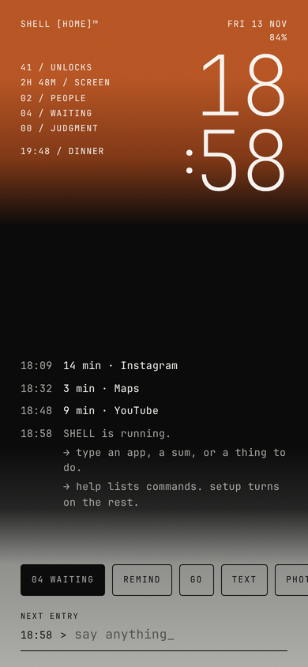
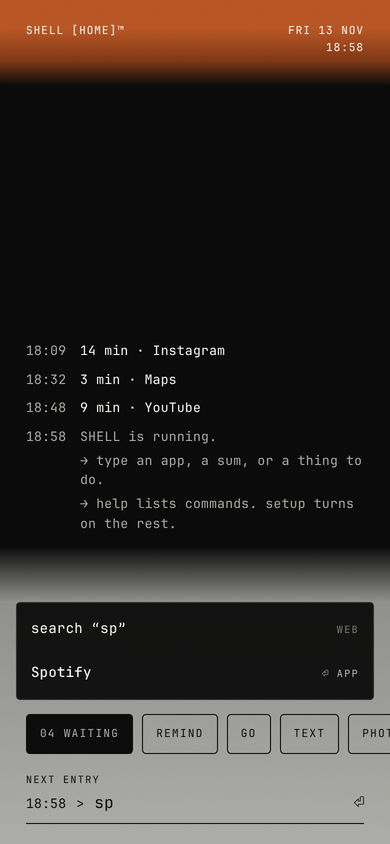
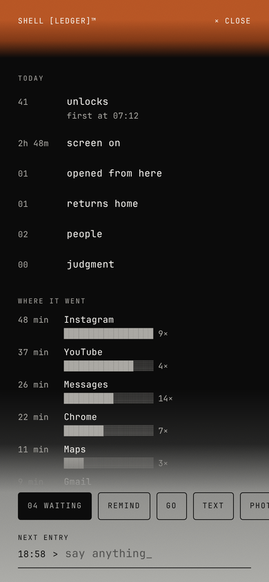
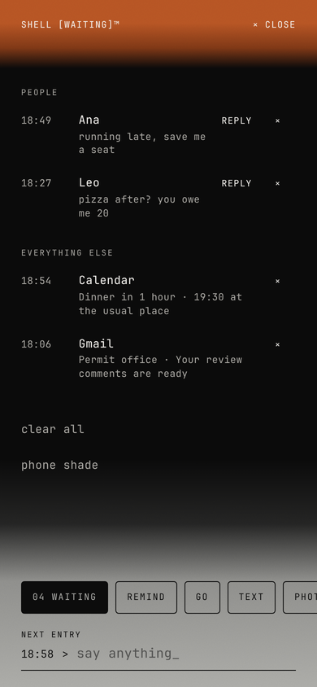

# How to use SHELL

SHELL is a home screen with no icons and no grid. You type at it, and it keeps a ledger of your day.

<p>




</p>

<sub>Screenshots use made-up data.</sub>

---

## 1. Install

1. On the phone, download the newest **[shell.apk](https://github.com/jere-mee-as/shell/releases/latest/download/shell.apk)** and open it. Allow the install when Android asks.
2. **Settings → Apps → SHELL → ⋮ → Allow restricted settings.** Android 13 and later block notification and usage access for apps installed outside the Play Store until you do this.
3. Open SHELL and type **`setup`**. Tap each line that says *off*:

| Permission | What it unlocks |
|---|---|
| **home app** | The home button opens SHELL |
| **usage access** | Unlocks, screen time, and the app sessions on the ledger |
| **notification access** | The waiting list, replying from SHELL, now playing |
| **contacts** | `call` and `text` people by name (starred contacts only) |
| **calendar** | Next event on the home screen, `week` |
| **phone** | `call` dials straight away instead of stopping at the dialer |
| **do not disturb** | `dnd` |
| **exact alarms** | Reminders that fire on the minute |

Only home app, usage and notification access really matter. The rest switch on single commands.

> **Updating:** type `update` to pull a newer page (most changes, no reinstall). `update app` downloads a newer APK. While the app is debug-signed, a new APK needs the old one uninstalled first.

---

## 2. The screen

```
┌─────────────────────────────────────┐
│ SHELL [HOME]™            FRI 13 NOV │  ← tap the title for help
│                                 84% │
│ 41 / UNLOCKS                  18    │
│ 2H 48M / SCREEN                     │  ← tap any number: the ledger
│ 03 / PEOPLE                  :30    │  ← tap the clock: the ledger
│ 04 / WAITING                        │     hold the clock: next colour
│ 00 / JUDGMENT                       │
│ 19:30 / DINNER                      │  ← next event, now playing
├─────────────────────────────────────┤
│ 18:02  > call dad                   │
│        → calling Dad                │  ← the ledger: what you ran,
│ 18:05  14 min · Instagram           │     and where the time went
│ 18:21  > text ana running late      │     tap a line to run it again
├─────────────────────────────────────┤
│ [04 WAITING] [REMIND] [GO] [TEXT] … │  ← chips
│ NEXT ENTRY                          │
│ 18:30 > say anything_               │  ← type here
└─────────────────────────────────────┘
```

**The numbers**

- **Unlocks / Screen:** from Android's usage stats, since midnight. Until usage access is on, these show *launches* (apps opened from SHELL) and *returns* (times you came back home).
- **People:** everyone who messaged you today, plus everyone you called, texted or replied to from SHELL.
- **Waiting:** notifications still sitting there.
- **Judgment:** always 00.

**The ledger** holds every command you ran and the answer, plus every app you used for a minute or more. Tap a line to put it back in the prompt. It keeps 14 days on the phone and sends nothing anywhere.

---

## 3. Typing

Tap the bottom line. (With a hardware keyboard, just start typing; ↑ and ↓ walk through your history.)

- Suggestions stack above the prompt. **The bottom one, marked ⏎, is what Enter runs.** Tap any other to run that one instead.
- Type an **app name**, or part of one: `sp` → Spotify, `gm` → Gmail. Apps you open often rise to the top.
- Type a **sum**: `18*4.5`, `(3+4)*2`, `15% x 80`, `2^10`. The answer is copied.
- Type a **contact's name**: it offers to call them.
- Type a **web address**: `jere.ing` opens it.
- Anything else falls through to a **web search**.
- Commands can start with `>`, `.` or `/` if that's your habit. All three are ignored.

**Back** clears the line, then hides the keyboard, then closes whatever panel is open. **Home** always returns to a clean home screen.

---

## 4. Gestures

| Do this | Get this |
|---|---|
| Swipe **up** on the ledger | All apps, A–Z |
| Swipe **down** from the top | Waiting (notifications) |
| Swipe **down** inside any panel | Close it |
| Tap the **clock** or a number | The full ledger |
| **Hold** the clock | Next colour theme |
| Tap the **title** | Help |
| **Hold** an app in the list | Pin it as a chip, hide it, rename it, app info, uninstall |
| **Hold** a chip | Put `chip rm <it>` in the prompt |

---

## 5. Commands

Words in `<angle brackets>` are yours to fill in. `[square brackets]` are optional.

### Do things

| Command | What it does |
|---|---|
| `call dad` · `call 555 0101` | Calls a starred contact, or a number |
| `text ana running late` | Opens your SMS app with the message drafted. You press send. |
| `reply leo on my way` | **Sends** a reply to Leo's latest notification, directly. `reply leo` alone lets you type it. |
| `remind 20m call the inspector` | A reminder notification. See *times* below. |
| `timer 10m pasta` | Starts a timer in the Clock app without opening it |
| `alarm 6:30am` · `alarm 7 gym` | Sets an alarm |
| `event dinner fri 7pm` | Opens a new calendar event, filled in |
| `note caulk, outlet covers` | Saves a note on the phone |
| `go reston town center` | Maps |
| `web tile spacers` · `? anything` | Web search |
| `open chrome` | Opens an app, even a hidden one |
| `photo` | Camera |
| `pay leo 20 for pizza` | Opens Venmo (or Cash App, PayPal, Zelle, Wallet) with that text on the clipboard. **You do the sending.** |
| `play` · `pause` · `next` · `prev` | Controls whatever is playing |
| `calc 18*4.5` | Same as typing the sum |

**Times** for `remind` and `event`: `20m`, `2h`, `in 3 days`, `6pm`, `6:30`, `at 7`, `tonight 8`, `tomorrow 9am`, `fri`, `sat 10am`. A bare day with no time means 9:00 (tonight means 20:00). A plain number without `at`, am/pm or a day is not read as a time.

### Look at things

| Command | Panel |
|---|---|
| `apps` · `apps all` | Every app (`all` includes hidden ones) |
| `waiting` | Notifications: people first, then everything else. Reply, ×, clear all. |
| `week` | Next 7 days of calendar |
| `ledger` | Today in numbers, where the time went, the last 7 days |
| `cal` | This month |
| `notes` · `reminders` | Tap a note to copy it; × to delete |
| `history` | Everything you've typed. Tap to bring one back. |
| `weather` · `weather set lisbon` | Current weather (Reston until you set a city) |
| `battery` | Percentage and charging |
| `help` | The command list |

### The phone

| Command | |
|---|---|
| `flash` · `flash off` | Flashlight |
| `dnd` · `dnd off` | Do not disturb |
| `settings` · `wifi` · `bt` · `settings display` | Jumps into Android settings |
| `shade` | Pulls down the real notification shade |
| `info spotify` | The app's options sheet |
| `uninstall reddit` | Asks y/n, then hands it to Android, which asks again |
| `setup` | Permissions, updates, phone info |
| `update` · `update app` | Newer page / newer APK |

### Make it yours

| Command | |
|---|---|
| `theme` | Opens the colour list. Or name one: `theme dusk` |
| | **ember** (default), **mono**, **dusk**, **moss**, **ice**, **blood**, **gold**, **rose**, **void** (all black, light text), **auto** (rose at dawn, ice by day, ember late afternoon, dusk in the evening, mono at night) |
| `chip add spotify` · `chip rm go` · `chip reset` | The buttons above the prompt. A chip can be any command or app. Chips that need more words (like `remind`) fill the prompt for you. |
| `alias sp = spotify` · `alias rm sp` · `alias` | Short names. The alias swaps out the first word, so `alias r = reply` makes `r ana ok` work. |
| `hide uber` · `unhide uber` | Keeps an app out of lists and suggestions. Typing its full name still finds it. |
| `clock 12` · `clock 24` | Clock format |
| `grain` · `crt` | Film grain on/off, scanlines on/off |
| `export` | Shares today's ledger as a text file |
| `clear` | Wipes today's ledger lines (app sessions come back from Android) |
| `reset` | Asks first, then erases everything SHELL saved |

Most commands have other names too. `ring`, `dial`, `sms`, `nav`, `maps`, `ls`, `inbox`, `agenda`, `today`, `torch`, `quiet` and friends all work.

---

## 6. Not on the help page

`help all` reveals some of these. Not all.

<details>
<summary>Spoilers</summary>

| Command | |
|---|---|
| `focus 25` · `focus off` | The big clock becomes a countdown. Notifies you when it ends. |
| `breathe` | 4-7-8 breathing, four rounds, full screen |
| `snake` | Snake. Swipe to steer, Back to leave. Your best score is kept. |
| `matrix` | Digital rain in your theme colour. Tap to leave. |
| `roll` · `roll 2d20` | Dice |
| `flip` | Coin |
| `8ball will it pass` | Answers |
| `fortune` | Wisdom, of a kind |
| `judgment` | Still 00 |
| `based` · `cope` · `touch grass` · `sudo` · `whoami` · `uptime` · `exit` · `vim` · `rm -rf` · `coffee` · `hola` · `gracias` | Try them |

</details>

---

## 7. Good to know

- **Nothing sends money.** `pay` stops at your payment app. **`text` stops at a draft.** Only `reply` sends on its own, because you wrote the reply.
- `call` and `text` find **starred** contacts only. Star people in your Contacts app.
- Everything SHELL saves (ledger, notes, aliases, chips, theme) stays on the phone.
- A broken page update can't brick it. If a downloaded page doesn't start within 10 seconds, SHELL throws it away and goes back to the one built into the app.
- Tablet or unfolded? Same layout, centred.
